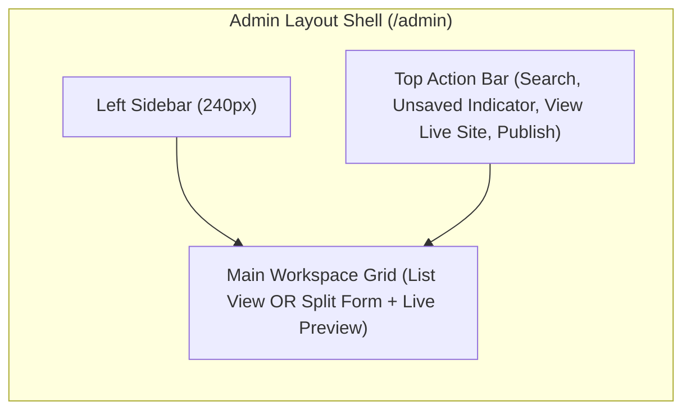
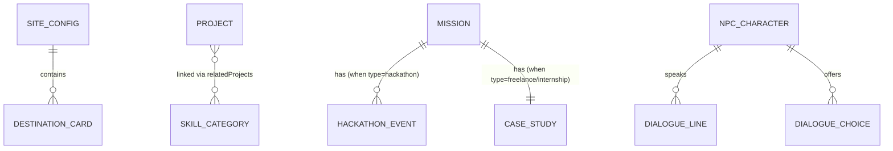

# NARUTO PORTFOLIO — COMPLETE ADMIN PANEL PLANNING & TECHNICAL AUDIT

> **Scope Verification:** This is a **100% read-only architectural & product audit** based on a full inspection of `d:/portfolio/naruto-room`. Zero existing project source files have been modified, refactored, or deleted, and zero packages have been installed.

---

## 1. Existing Portfolio Audit

### 1.1 Codebase Architecture & Stack Summary
- **Framework & Runtime:** Vite 8 + React 19 SPA ([`package.json`](file:///d:/portfolio/naruto-room/package.json)), Three.js (`three` + `@react-three/fiber` + `@react-three/drei`), and `gsap` (v3.14.2).
- **Routing:** **None (`react-router-dom` is not installed).** The app renders [`App.jsx`](file:///d:/portfolio/naruto-room/src/App.jsx) at `/` and switches between **3D Village Mode** (`viewMode === '3d'`) and **2D Portfolio Mode** (`viewMode === '2d'`, rendered via [`FallbackPortfolio2D.jsx`](file:///d:/portfolio/naruto-room/src/components/FallbackPortfolio2D.jsx)).
- **Existing Backend / Database / Auth:** **None.** There is no server, API, database, or authentication in the repository.
- **Existing Dynamic Storage Hook Found:** In [`src/config/locations.js`](file:///d:/portfolio/naruto-room/src/config/locations.js#L261-L320) and [`RamenBookModal.jsx`](file:///d:/portfolio/naruto-room/src/components/RamenBookModal.jsx#L33-L43), there is already a client-side `localStorage` override pattern (`ADMIN_PROJECTS_STORAGE_KEY = 'shinobi_portfolio_projects'` + custom event `'shinobi-projects-updated'`). However, it only persists in the visitor's local browser and has no admin UI or cloud database backing it yet.
- **Dual-Mode Content Consumption:** Both the **3D Village Modals** ([`PortfolioModals.jsx`](file:///d:/portfolio/naruto-room/src/components/PortfolioModals.jsx)) and the **2D Mode** ([`FallbackPortfolio2D.jsx`](file:///d:/portfolio/naruto-room/src/components/FallbackPortfolio2D.jsx)) mount the exact same section components (`EntryGate`, `RamenBookModal`, `AboutModal`, `SkillsModal`, `MissionScroll`, `ContactModal`, `ResumeViewerModal`) using the `embedded` prop. **Centralizing data in an API/database will automatically update both 3D and 2D modes simultaneously.**

---

### 1.2 Phase 1 Inventory Table (Hardcoded vs. Dynamic Audit)

| Existing Section | Current Content & Source File | Editable Fields Needed | Recommended Admin Feature | Priority |
|---|---|---|---|---|
| **00. 3D Sky Welcome Intro** | 4 hardcoded sentences in [`CinematicWelcomeIntro.jsx`](file:///d:/portfolio/naruto-room/src/components/CinematicWelcomeIntro.jsx#L5-L10) (`WELCOME_SENTENCES`) | Sentence list, hold duration, stagger speed, enable/disable toggle | **Hero & Intro Manager** (Ordered sentence list editor) | Medium |
| **01. Intro / Entry Gate (3D Modal & 2D Hero)** | Hardcoded profile hero (`"Hello, I’m Ashutosh."`, 3 role pills, quote, bio) in [`EntryGate.jsx`](file:///d:/portfolio/naruto-room/src/components/EntryGate.jsx#L121-L162) + 6 destination cards in [`entryDestinations.js`](file:///d:/portfolio/naruto-room/src/data/entryDestinations.js#L3-L19) | Greeting, headline, role badges, shinobi quote, description, CTA labels, 6 destination card titles/descriptions/thumbnails/visibility | **Hero & Entry Gate Editor** | High |
| **02. Projects — Ichiraku Ramen Menu Book** | 5 projects in [`locations.js`](file:///d:/portfolio/naruto-room/src/config/locations.js#L130-L259) (`PORTFOLIO_PROJECTS`) mapped via [`projectMenu.js`](file:///d:/portfolio/naruto-room/src/data/projectMenu.js) into [`RamenBookModal.jsx`](file:///d:/portfolio/naruto-room/src/components/RamenBookModal.jsx) & [`ProjectSpread.jsx`](file:///d:/portfolio/naruto-room/src/components/ProjectSpread.jsx) | `title`, `dishName` (Naruto ramen title), `category`, `frontPagePhoto`, `projectPhoto`, `screenshots[]`, `shortDesc`, `problemSolved`, `features[]`, `techStack[]`, `githubUrl`, `liveUrl`, `accent`, `order`, `visible`, `featured`, `status` | **Projects / Ramen Menu Manager** with live Book Spread Preview | **Critical (P0)** |
| **03. About — Hokage's Office** | 100% hardcoded in [`AboutModal.jsx`](file:///d:/portfolio/naruto-room/src/components/AboutModal.jsx#L4-L42): `INTEREST_ITEMS` (5), `SNAPSHOT_ITEMS` (4: Education at DJSCE, Development, Exploration, Goal), `DRIVE_VALUES` (3: Build, Learn, Grow), 3 bio paragraphs, portrait `/about/ashutosh-photo.jpg` | Profile photo, badge text, title, subtitle, 3 bio paragraphs, Interests cards (icon, label, subtext), Quick Snapshot cards (Education, CGPA/Year, Role, Goal), What Drives Me cards | **About & Education Editor** | **Critical (P0)** |
| **04. Skills — Training Grounds** | 7 skill categories in [`locations.js`](file:///d:/portfolio/naruto-room/src/config/locations.js#L322-L390) (`SKILL_SCROLLS`) + normalized in [`skillsData.js`](file:///d:/portfolio/naruto-room/src/data/skillsData.js) & rendered in [`SkillsModal.jsx`](file:///d:/portfolio/naruto-room/src/components/skills/SkillsModal.jsx) | Category `id`, `title`, `japaneseTitle`, `icon`, `summary`, `technologies[]` (name, badge/icon, proficiency), `relatedProjects[]` (linked project slugs), `order`, `visible` | **Skills & Jutsu Scrolls Manager** | **Critical (P0)** |
| **05. Missions — Mission Board (Experience & Hackathons)** | Stored in [`src/data/missions.js`](file:///d:/portfolio/naruto-room/src/data/missions.js) & queried via [`missionRepository.js`](file:///d:/portfolio/naruto-room/src/data/missionRepository.js) into [`MissionScroll.jsx`](file:///d:/portfolio/naruto-room/src/components/missions/MissionScroll.jsx). Has 3 mission types: `freelance` (G3Nxhat), `hackathon` (5 nested sub-events: HackNiche, Tech Fiesta, Lines of Code, Hackanova, Smart India Hackathon), and `internship` (placeholder) | Mission `type`, `category`, `title`, `organization`, `status`, `liveUrl`, `availableFrom`, `thumbnail`, `description`, `technologies[]`, `certificates[]`, `caseStudy` (`requirements[]`, `responsibilities[]`, `features[]`, `deployment`, `challenges[]`, `screenshots[]`), plus nested `events[]` for hackathons (`organiser`, `date`, `duration`, `team`, `project`, `achievement`, `certificates[]`) | **Missions, Experience & Hackathon Case-Study Manager** | **Critical (P0)** |
| **06. Contact — Hokage Monument** | Hardcoded constants in [`ContactModal.jsx`](file:///d:/portfolio/naruto-room/src/components/ContactModal.jsx#L6-L36): `CONTACT_EMAIL`, `GITHUB_URL`, `LINKEDIN_URL`, availability status (`"Available for Opportunities"`), and 4 contact directory cards | Email, GitHub URL, LinkedIn URL, additional socials (X/Twitter, LeetCode, Instagram, Discord), availability badge text & status toggle, location text, custom CTA message, optional Contact Form inbox | **Contact & Social Links Manager (+ Optional Message Inbox)** | High |
| **07. Resume PDF Viewer** | Hardcoded `const pdfUrl = '/Ashutosh_Kadam_Resume.pdf'` in [`ResumeViewerModal.jsx`](file:///d:/portfolio/naruto-room/src/components/ResumeViewerModal.jsx#L12) & [`ContactModal.jsx`](file:///d:/portfolio/naruto-room/src/components/ContactModal.jsx#L74) | Active Resume PDF file upload, display filename, last updated timestamp, version history, download toggle | **Resume Manager** (One-click PDF upload & swap) | **Critical (P0)** |
| **08. 3D Village NPCs & Cinematic Dialogues** | 8 speaker profiles (`SPEAKER_PROFILES`) & 7 NPC dialogue trees (`CHARACTERS_DATA`: Sasuke, Sakura, Tsunade, Jiraiya, Orochimaru, Kakashi, Hinata) in [`dialogueData.js`](file:///d:/portfolio/naruto-room/src/config/dialogueData.js) | Speaker name, role badge, accent color, portrait image, `dialogueSequence[]` lines, player `choices[]` (`text`, `action`, `replyDialogue[]`), `modalTarget`, NPC `visible` toggle | **NPC & Dialogue Tree Editor** | Medium |
| **09. 3D Village Landmarks & Navigation** | 6 landmarks in [`locations.js`](file:///d:/portfolio/naruto-room/src/config/locations.js#L8-L128) (`KONOHA_LOCATIONS`) + navbar items in [`KonohaHUD.jsx`](file:///d:/portfolio/naruto-room/src/components/KonohaHUD.jsx) & [`StickyNavbar2D.jsx`](file:///d:/portfolio/naruto-room/src/components/StickyNavbar2D.jsx) | Landmark name, subtitle, `kanji`, description, accent color, prompt text, navbar label, default theme (`day`/`night`), default mode (`3d`/`2d`) | **World & Navigation Settings** | Low / Advanced |
| **10. SEO & Site Metadata** | Basic static tags in [`index.html`](file:///d:/portfolio/naruto-room/index.html) | Page title, meta description, OpenGraph image, favicon, keywords, analytics script toggle | **Site & SEO Settings** | Medium |

---

### 1.3 Sections & Details You May Have Overlooked in the Codebase
1. **Ramen Menu Dual-Image Requirement:** Each project in [`locations.js`](file:///d:/portfolio/naruto-room/src/config/locations.js#L130-L259) uses **two** distinct images: `frontPagePhoto` (vertical dish card photo on the left page of [`ProjectSpread.jsx`](file:///d:/portfolio/naruto-room/src/components/ProjectSpread.jsx)) and `projectPhoto` (the actual app screenshot on the right detail page), plus `dishName` (e.g., `"Narutomaki AI Ramen"`). Your admin form must support both or auto-fallback `frontPagePhoto` to `projectPhoto`.
2. **Nested Hackathon Sub-Events vs. Freelance Case Studies:** In [`src/data/missions.js`](file:///d:/portfolio/naruto-room/src/data/missions.js), `MissionScroll.jsx` renders two completely different detail templates depending on `mission.type`:
   - `type: 'freelance'` or `'internship'` renders a **Case Study** (`requirements[]`, `responsibilities[]`, `features[]`, `deployment`, `challenges[]`, `screenshots[]`, `certificates[]`).
   - `type: 'hackathon'` renders a **Multi-Event Accordion/List** (`events[]`), where each hackathon has its own `title`, `organiser`, `date`, `duration`, `team`, `project`, `technologies[]`, `achievement`, and `certificates[]`.
3. **Cross-Linked Skills ↔ Projects:** In [`locations.js`](file:///d:/portfolio/naruto-room/src/config/locations.js#L334), each skill category has a `relatedProjects` array containing project IDs (`['travelflow-ai', 'wastewise', 'konoha-3d-portfolio']`). Clicking a related project inside `SkillsModal` opens `RamenBookModal` directly to that project. The Admin Panel should provide a multi-select dropdown of existing projects so links never break.

---

## 2. Complete Editable Content Inventory

| Section | Editable Fields | Add | Edit | Delete | Upload | Reorder | Hide/Show |
|---|---|:---:|:---:|:---:|:---:|:---:|:---:|
| **Projects (Ramen Book)** | Title, Dish Name, Slug, Category, Short Desc, Problem Solved, Features[], Tech Stack[], Thumbnail (`frontPagePhoto`), Main Screenshot (`projectPhoto`), Gallery Screenshots[], Demo Video URL, Live URL, GitHub URL, Extra Links[], Accent Color, Status, Featured, Order, Visible | ✅ | ✅ | ✅ | ✅ (Images/Video) | ✅ (Drag/Order) | ✅ |
| **Missions (Freelance / Internships)** | Title, Type (`freelance`/`internship`), Category Label, Organization, Role, Duration/Date, Status (`Completed`/`In Progress`/`Available`), Live URL, Thumbnail, Summary, Tech Stack[], Case Study (Requirements[], Responsibilities[], Features[], Deployment, Challenges[]), Screenshots[], Certificates[] | ✅ | ✅ | ✅ | ✅ (Screenshots & Certs) | ✅ | ✅ |
| **Hackathons & Competitions** | Event Title, Organiser, Date, Duration (e.g., `24 Hours`), Team Name/Size, Project Built, Description, Tech Stack[], Achievement/Rank Badge, Certificate Images/PDFs[], Repo/Demo Links, Order, Visible | ✅ | ✅ | ✅ | ✅ (Certs & Photos) | ✅ | ✅ |
| **Skills (Jutsu Scrolls)** | Category ID, Title, Japanese Title (`忍術`), Icon Key, Summary Paragraph, Technologies[] (Name, Level/Tag), Linked Related Projects[] (Project IDs), Order, Visible | ✅ | ✅ | ✅ | ⚪ (Optional SVG/Icon) | ✅ | ✅ |
| **About (Hokage Office)** | Header Badge, Title, Subtitle, Profile Photo, Bio Paragraphs[], Quick Snapshot Cards[] (Label, Heading, Body), Personal Interests[] (Icon, Label, Subtitle), Core Values[] (`Build`/`Learn`/`Grow`), Education Entries[] | ✅ (Cards) | ✅ | ✅ (Cards) | ✅ (Profile Photo) | ✅ | ✅ |
| **Hero / Entry Gate & Sky Intro** | Sky Welcome Sentences[4], Gate Eyebrow, Greeting (`Hello, I'm Ashutosh`), Role Badges[], Quote, Bio Intro, 6 Destination Cards (Title, Subtitle, Description, Image, Visible) | ✅ (Badges) | ✅ | ✅ (Badges) | ✅ (Gate Card WebPs) | ✅ | ✅ |
| **Contact & Socials** | Primary Email, GitHub URL, LinkedIn URL, Extra Socials[], Availability Status Text & Green Pulse Toggle, Location String, Contact Card Descriptions, Resume Quick-Link | ✅ (Socials) | ✅ | ✅ (Socials) | ❌ | ✅ | ✅ |
| **Resume / CV** | Active PDF File (`/Ashutosh_Kadam_Resume.pdf`), Display Title, Version Tag, Updated Date, Show/Hide Download Button | ✅ (New Version) | ✅ | ✅ (Old Versions) | ✅ (PDF) | ❌ | ✅ |
| **NPC Dialogues (3D World)** | Character Name, Role Title, Portrait Image, Accent Color, Greeting Sequence Lines[], Player Choices[] (Prompt Text, Action Type, Reply Lines[], Target Modal), Character Visibility | ⚪ (Lines/Choices) | ✅ | ⚪ (Lines/Choices) | ✅ (Portraits) | ✅ (Lines) | ✅ (NPCs) |
| **Site & SEO Settings** | Site Title, Meta Description, OG Image, Favicon, Default View Mode (`3d` vs `2d`), Default Time of Day (`day` vs `night`), Maintenance Mode Toggle | ❌ | ✅ | ❌ | ✅ (OG/Favicon) | ❌ | ❌ |

---

## 3. Missing Portfolio Features That Should Be Added

| Feature | Currently Exists? | Needed Now or Later? | Why It Is Useful for Your Portfolio | Implementation Complexity | Priority |
|---|---|---|---|---|---|
| **1. Dedicated Education Sub-Section** | **Partially** (Hardcoded as 1 small card inside `SNAPSHOT_ITEMS` in [`AboutModal.jsx`](file:///d:/portfolio/naruto-room/src/components/AboutModal.jsx#L15-L19): *DJSCE — B.Tech AI & ML*) | **Needed Now (V1)** | Recruiters look for graduation year, CGPA, coursework, and college achievements immediately. Can be rendered cleanly inside Hokage Office (About) & 2D mode without clutter. | Low | **High** |
| **2. Resume Version Manager** | **Hardcoded Static File** (`/Ashutosh_Kadam_Resume.pdf` in `public/`) | **Needed Now (V1)** | Lets you swap your resume PDF in 5 seconds before applying to a company without running `git push` or rebuilding Vite. | Low | **Critical (P0)** |
| **3. Media Library & Asset Uploader** | **No** (All images are static files in `public/`) | **Needed Now (V1)** | Essential for uploading project screenshots, hackathon certificates, profile photos, and resume PDFs with automatic WebP compression. | Medium | **Critical (P0)** |
| **4. Dedicated Certifications & Achievements Drawer/Tab** | **Partially** (Certificates are buried inside individual hackathon/freelance modals in [`missions.js`](file:///d:/portfolio/naruto-room/src/data/missions.js)) | **Needed in V1.5 / V2** | Gives recruiters a single place (e.g., a tab in Missions or Skills) to view course certificates (AWS, DeepLearning.AI, NPTEL) and awards alongside hackathon certificates. | Low | Medium |
| **5. Positions of Responsibility (POR) / Leadership** | **No** | **Later (V2)** | College committees, technical club roles (e.g., AI/ML Lead, Hackathon Organizer) fit naturally as a mission category (`type: 'leadership'`) inside `MissionScroll.jsx`. | Very Low (Reuses `MissionScroll`) | Medium |
| **6. Contact Form + Admin Message Inbox** | **No** (`ContactModal.jsx` only has `mailto:` and `Copy Email`) | **Optional (V2)** | Allows visitors without a configured mail client to send a message directly from Hokage Monument, stored in your Admin Inbox with email notification. | Low-Medium | Medium |
| **7. SEO & OpenGraph Manager** | **Static HTML only** | **Needed Now (V1)** | Controls how your portfolio link previews when shared on LinkedIn, X, WhatsApp, or Discord. | Low | Medium |
| **8. Lightweight Portfolio Analytics** | **No** | **Optional (V2)** | Tracks how many visitors use 3D vs 2D mode, which projects are opened most in the Ramen Book, and how many times your Resume is downloaded. | Low | Low |
| **9. Testimonials / Recommendations** | **No** | **Later (Future)** | Useful for freelance clients (like G3Nxhat) or internship mentors to leave quotes; can be displayed inside freelance case studies or About. | Low | Low |

---

## 4. Recommended Admin Sidebar Structure

Designed specifically for **a single admin (you)**—fast, zero bloat, grouped logically by how your portfolio is structured:

```text
🥷 SHINOBI CMS (Admin Panel)
├── 📊 Dashboard (Overview, Quick Actions, Draft Count, Live Site Link)
│
├── 🍜 Content Management
│   ├── 01. Hero & Entry Gate     (Sky Intro Sentences, Gate Profile, 6 Destination Cards)
│   ├── 02. Projects (Ramen Book) (Projects CRUD, Tech Stack, Screenshots, Page Order)
│   ├── 03. Missions & Experience (Freelance, Internships, Case Studies, POR)
│   ├── 04. Hackathons & Certs    (Hackathon Events, Ranks, Certificates, Team Details)
│   ├── 05. Skills (Jutsu Scrolls)(7 Skill Categories, Tech Badges, Related Projects)
│   ├── 06. About & Education     (Bio, DJSCE Education, Snapshot Cards, Interests, Values)
│   └── 07. Contact & Socials     (Email, GitHub, LinkedIn, Availability Status, Inbox)
│
├── 📄 Assets & Documents
│   ├── Resume / CV Manager       (Upload & Activate PDF, Version History)
│   └── Media Library             (Project WebPs, Certificates, Portraits, Auto-Optimize)
│
├── 🏮 3D Village Config (Advanced)
│   └── NPC Dialogues & World     (Sasuke/Sakura/Tsunade/Kakashi/Hinata Lines & Defaults)
│
└── ⚙️ System
    ├── SEO & Site Settings       (Meta Title, OG Image, Default 3D/2D & Day/Night)
    └── Backup & JSON Export      (1-Click Export/Import Full Portfolio JSON Snapshot)
```

---

## 5. Admin UI/UX Blueprint

### 5.1 Design Language & Theme
- **Aesthetic:** Clean, dark-mode-first modern developer studio UI (inspired by **Linear / Vercel / Raycast** with subtle **Konoha warm amber `#e68a2e` & crimson `#a84434` accents**).
- **Why not heavy Naruto parchment inside Admin?** Your public portfolio already has rich theatrical textures; the admin panel should prioritize **high contrast, scannability, fast keyboard shortcuts (`Ctrl+S` to save, `Ctrl+K` quick jump), and zero visual fatigue**.

### 5.2 Screen-by-Screen Layout Blueprint



1. **Login Screen (`/admin/login`):**
   - Centered minimal card with Shinobi crest, Email/Username + Password input, Show/Hide password toggle, rate-limit warning badge, and `"Return to Village"` link.
2. **Dashboard Home (`/admin`):**
   - **Top Row Stat Cards:** Total Published Projects (`5`), Active Missions (`2`), Hackathons Logged (`5`), Skill Categories (`7`), Resume Status (`Active • Updated X days ago`).
   - **Quick Actions Bar:** `+ New Project`, `+ Log Hackathon`, `+ Upload New Resume PDF`, `Export JSON Backup`.
   - **System Health & Storage:** Database connection status, Cloudinary/Storage media usage meter, and a toggle to preview changes before publishing.
3. **Projects — Ramen Book Manager (`/admin/projects`):**
   - **Top Controls:** Search bar, Category filter (`All`, `Full-Stack`, `AI / ML`, `Interactive 3D`), `+ Add Project` button, and **Drag-and-Drop Reorder Toggle**.
   - **Split Editor Drawer / Page:**
     - **Left Pane (Form):** Basic Info (`Title`, `Ramen Dish Name`, `Category`, `Accent Color Picker`), Descriptions (`Short Menu Summary` with character counter so it never overflows the left book page, `Problem Solved`), Dynamic Chip Input for `Tech Stack[]`, Dynamic Bullet Builder for `Key Features[]`, Media Uploaders (`Menu Dish Photo`, `Main App Screenshot`, `Additional Screenshots[]`), and Links (`GitHub URL`, `Live Demo URL`).
     - **Right Pane (Live Ramen Book Spread Preview):** Renders the actual [`ProjectSpread`](file:///d:/portfolio/naruto-room/src/components/ProjectSpread.jsx) component in real time so you can immediately see if text fits the parchment page without clipping!
4. **Missions & Hackathons Manager (`/admin/missions`):**
   - **Tabbed Interface:** `Freelance & Client Work` | `Internships` | `Hackathons & Events`.
   - **Case Study Builder (for Freelance/Internships):** Structured repeatable list inputs for `Requirements`, `Responsibilities`, `Features`, `Deployment`, `Challenges`, plus multi-image uploader for `Screenshots` and `Certificates`.
   - **Hackathon Event Drawer:** Dedicated sub-item manager for `events[]` (`Title`, `Organiser`, `Date`, `Duration`, `Team`, `Project Name`, `Achievement Badge`, `Certificate Upload`).
5. **Skills — Jutsu Scrolls Editor (`/admin/skills`):**
   - Left column lists the 7 categories (`Frontend`, `Backend`, `Python`, `AI & ML`, `Databases`, `APIs`, `Tools`) with drag handles.
   - Right panel edits `Title`, `Japanese Kanji Title`, `Summary`, a tag-manager for `Technologies[]`, and a **Multi-Select Project Linker** populated dynamically from your Projects collection.
6. **NPC Dialogue Tree Editor (`/admin/dialogues`):**
   - Character selector cards (`Sasuke`, `Sakura`, `Tsunade`, `Jiraiya`, `Orochimaru`, `Kakashi`, `Hinata`).
   - Visual sequential list of `dialogueSequence` lines (with speaker dropdown `Character` vs `Ashutosh`) and `choices[]` builder showing which modal (`projects`, `about`, `skills`, `missions`, `contact`) opens on completion.

### 5.3 Recommended UI Component Libraries (Lightweight & Compatible with React 19)
- **Icons:** `lucide-react` (clean, lightweight SVG icons).
- **Drag-and-Drop Reordering:** `@dnd-kit/core` + `@dnd-kit/sortable` (modern, accessible, works great with React 19).
- **Toast Notifications:** `sonner` (ultra-lightweight toast alerts for Save/Upload/Error feedback).
- **Forms & Validation:** Native controlled React state + `zod` schema validation (keeps bundle size tiny and avoids heavy form library conflicts).

---

## 6. Recommended Database Schema

Whether stored in **MongoDB** (collections) or **Supabase/PostgreSQL** (tables) with a local JSON fallback, here is the exact schema mapped to your existing frontend props:



### 6.1 `projects` Collection (Maps to `PORTFOLIO_PROJECTS` & `RamenBookModal`)
```json
{
  "_id": "uuid-or-objectid",
  "id": "travelflow-ai",
  "title": "TravelFlow AI",
  "dishName": "Narutomaki AI Ramen",
  "category": "AI / Full-Stack",
  "frontPagePhoto": "https://res.cloudinary.com/.../travelflow-menu.webp",
  "projectPhoto": "https://res.cloudinary.com/.../travelflow-app.webp",
  "screenshots": ["https://.../1.webp", "https://.../2.webp"],
  "demoVideoUrl": "",
  "shortDesc": "Intelligent itinerary planner with real-time route optimization.",
  "problemSolved": "Eliminates hours of manual travel planning...",
  "features": ["AI itinerary generation", "Interactive map routing"],
  "techStack": ["React", "Node.js", "FastAPI", "OpenAI"],
  "githubUrl": "https://github.com/ashutosh607/...",
  "liveUrl": "https://...",
  "extraLinks": [{ "label": "Demo Video", "url": "https://..." }],
  "accent": "#e68a2e",
  "role": "Lead Full-Stack Developer",
  "completionDate": "2025-02",
  "status": "published",
  "featured": true,
  "visible": true,
  "order": 1,
  "updatedAt": "2026-11-09T10:00:00Z"
}
```

### 6.2 `missions` Collection (Maps to `src/data/missions.js` & `MissionScroll.jsx`)
```json
{
  "_id": "uuid-or-objectid",
  "id": "freelance-g3nxhat",
  "type": "freelance",
  "category": "Freelance Projects",
  "order": 1,
  "visible": true,
  "title": "G3Nxhat Cybersecurity Platform",
  "organization": "G3Nxhat",
  "role": "Full-Stack Freelance Developer",
  "thumbnail": "/missions/g3nxhat/thumb.webp",
  "status": "Completed",
  "liveUrl": "https://...",
  "availableFrom": null,
  "description": "End-to-end development...",
  "technologies": ["React", "Next.js", "Tailwind CSS"],
  "certificates": ["/missions/g3nxhat/cert.webp"],
  "caseStudy": {
    "requirements": ["..."],
    "responsibilities": ["..."],
    "features": ["..."],
    "deployment": "Vercel + Cloudflare",
    "challenges": ["..."],
    "screenshots": ["/missions/g3nxhat/1.webp"]
  },
  "events": [
    {
      "id": "hackniche",
      "title": "HackNiche",
      "organiser": "DJSCE",
      "date": "2024",
      "duration": "24 Hours",
      "team": "4 Members",
      "project": "WasteWise",
      "technologies": ["React", "Python", "YOLO"],
      "achievement": "Finalist",
      "certificates": ["/missions/hackathons/hackniche-cert.webp"],
      "visible": true,
      "order": 1
    }
  ]
}
```

### 6.3 `skill_categories` Collection (Maps to `SKILL_SCROLLS` & `SkillsModal.jsx`)
```json
{
  "id": "frontend",
  "title": "Frontend Architecture",
  "japaneseTitle": "風遁・フロントエンド",
  "icon": "frontend",
  "summary": "Building responsive, high-frame-rate interfaces and 3D web experiences.",
  "technologies": ["React.js", "Three.js / R3F", "GSAP", "Tailwind CSS", "TypeScript"],
  "relatedProjects": ["konoha-3d-portfolio", "travelflow-ai"],
  "order": 1,
  "visible": true
}
```

### 6.4 `profile_about` Singleton Document (Maps to `AboutModal.jsx` & `EntryGate.jsx`)
```json
{
  "hero": {
    "welcomeSentences": [
      "Welcome to the Hidden Leaf Village.",
      "Every corner holds a part of my story.",
      "Explore the village. Discover my journey.",
      "Find the gate. Your adventure begins there."
    ],
    "greeting": "Hello, I’m Ashutosh.",
    "roleBadges": ["AI/ML Developer", "Full-Stack Developer", "Problem Solver"],
    "quote": "A shinobi of code, building things worth discovering.",
    "introBio": "..."
  },
  "about": {
    "badge": "HOKAGE'S OFFICE • PERSONAL DOSSIER",
    "title": "Ashutosh Kadam",
    "subtitle": "AI & ML Engineering Student • Full-Stack & 3D Web Developer",
    "photoUrl": "/about/ashutosh-photo.jpg",
    "bioParagraphs": ["...", "...", "..."],
    "snapshotItems": [
      { "label": "EDUCATION", "title": "DJ Sanghvi College of Engineering", "desc": "B.Tech in Artificial Intelligence & Machine Learning" }
    ],
    "interestItems": [
      { "icon": "⚽", "label": "Football", "sub": "Pitch strategy & teamwork" }
    ],
    "driveValues": [
      { "num": "01", "title": "Build", "desc": "..." }
    ]
  }
}
```

### 6.5 `contact_resume` Singleton Document (Maps to `ContactModal.jsx` & `ResumeViewerModal.jsx`)
```json
{
  "email": "ashutoshkadam607@gmail.com",
  "githubUrl": "https://github.com/ashutosh607",
  "linkedinUrl": "https://www.linkedin.com/in/Ashutosh-kadam",
  "availabilityText": "Available for Opportunities",
  "isAvailable": true,
  "resume": {
    "activePdfUrl": "/Ashutosh_Kadam_Resume.pdf",
    "fileName": "Ashutosh_Kadam_Resume.pdf",
    "updatedAt": "2026-11-09T10:00:00Z",
    "history": []
  }
}
```

### 6.6 `npc_dialogues` & `media_assets` Collections
- **`npc_dialogues`:** Stores `SPEAKER_PROFILES` and `CHARACTERS_DATA` (`id`, `name`, `role`, `portrait`, `dialogueSequence[]`, `choices[]`, `visible`).
- **`media_assets`:** Tracks every uploaded image/PDF (`id`, `url`, `publicId`, `fileName`, `mimeType`, `sizeBytes`, `width`, `height`, `usedInSection`, `createdAt`).

---

## 7. Backend & Architecture Recommendation

### 7.1 Comparison of 4 Architectural Options

| Criteria | **Option 1: Node.js + Express + MongoDB Atlas + Cloudinary** | **Option 2: Supabase (PostgreSQL + Auth + Storage)** | **Option 3: Firebase (Firestore + Auth + Storage)** | **Option 4: Sanity / Strapi Headless CMS** |
|---|---|---|---|---|
| **Setup Speed** | Medium (Requires building Express API + deploying backend) | **Fastest** (Zero backend server to maintain; direct SDK + RLS) | Fast (NoSQL SDK, but Storage requires billing setup on newer tiers) | Medium (Separate studio project & schema DSL) |
| **Custom Naruto UI Fit** | **100% Custom** (Supports live `RamenBookModal` spread preview inside admin) | **100% Custom** (React admin inside `/admin` talks directly to Supabase) | **100% Custom** | Generic CMS Studio UI (Harder to embed live Ramen Book preview) |
| **Hosting & Deployment** | Frontend on Vercel + Express API on Render/Railway (Free tier cold starts ~30s!) | **Single deployment on Vercel!** Supabase cloud has **zero cold starts** | Single deployment on Vercel | Separate Studio + API hosting |
| **Media & Resume Storage** | **Cloudinary Free Tier** (25GB, automatic WebP transform) | **Supabase Storage Free Tier** (1GB built-in bucket for PDFs & images) | Firebase Storage | Built-in asset pipeline |
| **Free-Tier Friendliness** | High (MongoDB M0 512MB + Cloudinary) — *Watch out for Render free tier spin-down* | **Highest** (500MB DB + 1GB Storage + Built-in Auth, no server spin-down) | Medium | Medium |
| **Portfolio Value (Resume Flex)** | **Very High** (Full MERN Stack + JWT + Cloudinary architecture) | **Very High** (Modern BaaS + PostgreSQL + Row Level Security) | High | Medium |

### 7.2 Primary Architect Recommendation

> **Recommended Architecture: Hybrid Repository Pattern with Static Fallback**
> Regardless of whether you pick **Option 1 (Node.js + Express + MongoDB + Cloudinary — Best for showcasing full-stack MERN skills on your resume)** or **Option 2 (Supabase — Best for zero-backend maintenance and instant speed)**, we should implement a **Unified Data Provider (`PortfolioDataContext`) with Static Bundled Fallback**.

**Why this is critical for your 3D portfolio:**
1. When a visitor opens your portfolio, **the app renders immediately in 0ms** using the bundled static data files (`locations.js`, `missions.js`, `dialogueData.js`) as the initial state, **plus a cached snapshot in `localStorage`**.
2. In the background, `PortfolioDataContext` fetches the latest published JSON from the API/Database and seamlessly hydrates any updates.
3. **If the backend is ever offline, cold-starting, or rate-limited, your 3D Konoha village and 2D portfolio still work 100% flawlessly with zero loading spinners or broken screens.**
4. In the Admin Panel, we also include a **"Download `portfolio-snapshot.json` / Sync to Static Files"** button so you can commit your latest database state directly into Git whenever you want.

---

## 8. Security Checklist

1. **Admin Route Isolation:** Lazy-load the entire Admin bundle (`const AdminApp = React.lazy(() => import('./admin/AdminApp'))`) so regular portfolio visitors never download admin code, forms, or schemas.
2. **Authentication:**
   - Single-admin email + password authentication.
   - Passwords hashed with `bcrypt` (cost factor $\ge 12$) if using Express/MongoDB, or managed via Supabase Auth.
   - `httpOnly`, `Secure`, `SameSite=Strict` cookies for JWT refresh tokens + short-lived access tokens (15 min).
3. **Login Rate Limiting:** Strict IP rate limiter (`express-rate-limit`: max 5 failed login attempts per 15 minutes) to block brute-force bots.
4. **Public Read vs. Protected Write:**
   - `GET /api/portfolio` is public and cached (`Cache-Control: s-maxage=60, stale-while-revalidate`).
   - All `POST / PUT / PATCH / DELETE` and `/api/upload` endpoints require a valid Admin JWT middleware check.
5. **Upload Validation:**
   - Restrict images to `.jpg, .jpeg, .png, .webp, .avif` (max `5 MB`) and documents strictly to `.pdf` (max `10 MB`).
   - Verify MIME magic bytes on the server, never allow `.html`, `.svg` (unless sanitized), or `.exe/.js` uploads.
6. **Input Sanitization:** Render all dynamic text through React's default JSX escaping (never use `dangerouslySetInnerHTML` for bio/descriptions) and validate payloads with `zod`.
7. **Zero Client Secrets:** Store database URIs, JWT secrets, and Cloudinary API secrets strictly in backend `.env` variables, never in Vite `VITE_*` client variables.

---

## 9. Integration Risks & How to Avoid Breaking the 3D/2D Portfolio

| Component / Mechanic | What Could Break When Making It Dynamic? | Architectural Safeguard |
|---|---|---|
| **1. Ichiraku Ramen Book 3D Page-Turn (`RamenBookModal.jsx` + `PageTurnSurface.jsx`)** | `RamenBookModal` clones DOM nodes (`prepareInnerCover`) and calculates spread indices (`PROJECTS_PER_SPREAD = 3`, `menuPages = Math.ceil(projects.length / 3)`). If `projects` changes mid-animation or if a project lacks `frontPagePhoto` / `shortDesc` overflows the fixed book height, the 3D page curl can glitch. | 1. Filter only `visible: true` projects sorted by `order` **before** passing to `RamenBookModal`.<br>2. Enforce character limits on `shortDesc` ($\le 140$ chars) and `features[]` (max 5 bullets) in the Admin Form.<br>3. Auto-fallback `frontPagePhoto` to `projectPhoto` if omitted. |
| **2. GSAP Word-by-Word Welcome Intro (`CinematicWelcomeIntro.jsx`)** | `CinematicWelcomeIntro` pre-splits `WELCOME_SENTENCES` on mount and runs a GSAP timeline once `isSceneLoaded` is true. If sentences arrive asynchronously *after* `isSceneLoaded`, the timeline might either restart mid-flight or miss the update. | Lock the intro sentences snapshot at the moment `isSceneLoaded` becomes `true`, and cache the admin-updated sentences in `localStorage` so the very next load uses them synchronously at frame 0. |
| **3. Mission Scroll Unrolling & Dynamic Height (`MissionScroll.jsx`)** | `MissionScroll.jsx` uses GSAP scroll-unroll animations and switches templates based on `mission.type` (`freelance` vs `hackathon` vs `internship`). | Validate in Admin that `type === 'hackathon'` always initializes `events: []` and `type === 'freelance' \| 'internship'` initializes `caseStudy: { requirements: [], responsibilities: [], features: [], challenges: [], screenshots: [] }`. |
| **4. 3D NPC Proximity & Dialogue (`VillageCharacters.jsx` + `CinematicDialogue.jsx`)** | `VillageCharacters.jsx` loads `.glb` models from `data.modelPath` and applies custom bone rotations in [`poseUtils.js`](file:///d:/portfolio/naruto-room/src/utils/poseUtils.js) by matching `data.id` (`sasuke`, `sakura`, `tsunade`, `jiraiya`, `orochimaru`, `kakashi`, `hinata`). | **Keep 3D `.glb` paths, bone pose adjustments, and 3D coordinates locked in code** (or behind an "Advanced 3D Transform" lock), while making **portraits, speaker names, dialogue lines, choices, and modal targets** 100% editable in the Admin Panel. |
| **5. 3D WebGL Frame Rate (FPS) & Memory** | Unoptimized 4K PNG uploads from an admin panel will bloat GPU texture memory and drop 3D Village FPS on mobile devices. | Automatically convert all uploaded project/mission images to **WebP ($\le 1600\text{px}$ width, quality 82)** via Cloudinary transformations or a build/upload sharp pipeline. |

---

## 10. Step-by-Step Development Roadmap

### Phase A — Data Layer Refactor & Central Store (Foundation)
- **Features:** Create a unified `PortfolioDataContext` that wraps [`App.jsx`](file:///d:/portfolio/naruto-room/src/App.jsx), [`FallbackPortfolio2D.jsx`](file:///d:/portfolio/naruto-room/src/components/FallbackPortfolio2D.jsx), and [`PortfolioModals.jsx`](file:///d:/portfolio/naruto-room/src/components/PortfolioModals.jsx). Replace hardcoded constants in `AboutModal.jsx`, `ContactModal.jsx`, `EntryGate.jsx`, `ResumeViewerModal.jsx`, and `CinematicWelcomeIntro.jsx` with context hooks that fall back 100% to your current static data.
- **Complexity:** Low-Medium | **Risk:** Near Zero (Visual output remains 100% identical).
- **Testing:** Verify all 6 sections in both 3D Village and 2D Portfolio modes render identically on desktop and mobile.

### Phase B — Backend / Database & Auth Setup
- **Features:** Set up Backend API + Database (Node/Express/MongoDB or Supabase), seed the database automatically with your exact current portfolio data (`5 projects`, `missions`, `5 hackathons`, `7 skill scrolls`, `About`, `Contact`, `7 NPC dialogues`), and implement `/admin/login` with JWT authentication.
- **Complexity:** Medium.
- **Testing:** Test login, token refresh, unauthorized route blocking, and instant static fallback when offline.

### Phase C — Core Content Managers (Projects, Missions, Hackathons, Skills)
- **Features:** Build the Admin Shell (`/admin`) + CRUD interfaces for **Projects (with live Ramen Book Spread Preview)**, **Missions & Freelance Case Studies**, **Hackathon Events**, and **Skills / Jutsu Scrolls** (with drag-and-drop reordering and project linking).
- **Complexity:** Medium-High.
- **Testing:** Add a draft project, preview it inside the Ramen Book spread, reorder projects, publish, and verify both 3D Ichiraku Ramen and 2D Projects update immediately.

### Phase D — Profile, Resume, Media Uploader & Contact Managers
- **Features:** Build the **About & Education Editor**, **Contact & Availability Manager**, **One-Click Resume PDF Uploader**, and **Media Library** (with WebP optimization).
- **Complexity:** Medium.
- **Testing:** Upload a new Resume PDF and verify [`ResumeViewerModal.jsx`](file:///d:/portfolio/naruto-room/src/components/ResumeViewerModal.jsx) displays the new PDF immediately.

### Phase E — 3D Village NPC Dialogue Editor, SEO & Backup Polish
- **Features:** Build the **NPC Dialogue Tree Editor**, **Hero / Sky Intro Sentence Editor**, **SEO Settings**, and **1-Click JSON Export/Import Backup**.
- **Complexity:** Low-Medium.
- **Testing:** Edit a dialogue line for Kakashi/Sakura, test in 3D Village, and run a full production Vite build (`vite build`).

---

## 11. Final Prioritized Recommendations

### Must Have — Version 1 (Core CMS)
1. **Unified Portfolio Data Provider + Instant Static Fallback** (Zero loading delay in 3D/2D).
2. **Secure Admin Login (`/admin`)** with protected routes and lazy-loaded bundle.
3. **Projects (Ramen Book) Manager** with live Spread Preview, tech stack tags, links, reorder, and draft/visibility toggles.
4. **Missions & Hackathons Manager** supporting both Freelance/Internship Case Studies and Hackathon Sub-Events + Certificates.
5. **Skills (Jutsu Scrolls) Manager** with category reordering and Related Projects multi-select.
6. **About, Education & Hero Gate Manager** (Profile photo, bio, DJSCE education card, snapshot cards, interests, sky intro sentences).
7. **Contact & One-Click Resume PDF Manager** (Swap `/Ashutosh_Kadam_Resume.pdf` and toggle availability status).
8. **Media Uploader** (Auto-WebP conversion for screenshots/certificates + PDF support) & **1-Click JSON Backup Export**.

### Should Have — Version 2 (Enhanced Control)
1. **3D NPC Dialogue & Choice Tree Editor** (Edit Sasuke, Sakura, Tsunade, Jiraiya, Orochimaru, Kakashi, and Hinata conversations from the browser).
2. **Dedicated Certifications & Achievements Showcase** (For standalone course/cloud certifications).
3. **Direct Contact Form + Admin Inbox** inside `ContactModal.jsx`.
4. **SEO & OpenGraph Meta Editor** + Default Mode (`3D` vs `2D`, `Day` vs `Night`) toggles.

### Optional — Future
1. **Lightweight Privacy-Friendly Analytics** (3D vs 2D mode split, most-viewed projects, resume download counter).
2. **Testimonials / Client Endorsements** linked to Freelance missions.

### Not Recommended (Over-Engineering to Avoid)
- **Full 3D Scene / Blender Coordinate Editor in CMS:** Editing 3D mesh transforms, terrain colliders, or GLB bone rotations from a web database adds fragility and offers little day-to-day value compared to keeping 3D geometry in code.
- **Multi-User RBAC / Complex Role Permissions:** You are the sole owner of this portfolio; single-admin authentication is faster, simpler, and more secure.
- **Heavy WYSIWYG HTML Editors (e.g., TinyMCE/CKEditor):** Raw HTML injection breaks carefully styled Naruto parchment cards and custom typography. Structured fields + bullet arrays keep your design 100% consistent.

---

## 12. Questions Before Implementation

Before we begin building **Phase A**, please let me know your preferences on these **4 quick architectural choices** (or tell me to use the recommended defaults):

1. **Backend & Storage Stack:**
   - **Option A (Recommended for Full-Stack Resume Flex):** Custom **Node.js + Express + MongoDB Atlas + Cloudinary** (with local JSON snapshot sync).
   - **Option B (Recommended for Fastest Zero-Server Deployment):** **Supabase** (PostgreSQL + Supabase Auth + Supabase Storage for images & Resume PDF — runs 100% on Vercel with zero cold starts).
2. **Admin URL Route:**
   - Should the admin panel live at **`/admin`** inside the same app (lazy-loaded so it adds 0 KB to the public bundle) — **(Recommended)**?
3. **Contact Section Behavior:**
   - Do you want to keep the current clean **Directory Cards (`Email`, `GitHub`, `LinkedIn`, `Resume`)** with editable links, or also add a **Send Message Form** that saves visitor messages to your Admin Panel?
4. **Implementation Scope:**
   - Would you like me to start by implementing the **Must-Have Version 1 (Phases A → D)** first, or include the **NPC Dialogue Editor (Phase E)** in the initial build as well?

