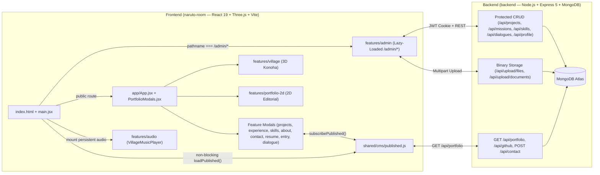

# System & Codebase Architecture (`d:\portfolio`)

This document describes the enterprise feature-sliced architecture of the **Ashutosh Kadam — Interactive 3D & 2D Shinobi Portfolio** repository (`naruto-room/` frontend and `backend/` API).

---

## 1. High-Level System Architecture



---

## 2. Frontend Architecture (`naruto-room/src/`)

The frontend is organized into three primary layers:

1. **Application Layer (`src/app/`)**: Owns global state orchestration, performance/FPS monitoring, 3D-to-2D mode transitions, global styles, and modal composition.
2. **Feature Layer (`src/features/*`)**: Domain-isolated feature modules. Each feature owns its React components, styles, hooks, configuration, and fallback seed data.
3. **Shared Layer (`src/shared/*`)**: Cross-cutting utilities, shared SVG icons, and the singleton CMS data store used across multiple features.

### 2.1 Complete Frontend Directory Breakdown

```text
naruto-room/src/
├── main.jsx                                         # Entry point: splits /admin lazy route vs public portfolio boot
├── app/
│   ├── App.jsx                                      # Root state machine (3D Canvas, 2D fallback, FPS guard, dialogue/modal state)
│   ├── App.css                                      # Application shell layout styles
│   ├── PortfolioModals.jsx                          # Central modal router (lazy-loads SkillsModal, renders active feature modal)
│   └── index.css                                    # Global design tokens, reset, typography
├── features/
│   ├── about/
│   │   ├── AboutModal.jsx                           # Location 02: Hokage Monument bio & philosophy modal
│   │   ├── AboutModal.css
│   │   └── favoriteAnime.js                         # Curated anime cards configuration
│   ├── admin/
│   │   ├── AdminApp.jsx                             # Lazy-loaded /admin router & auth guard
│   │   ├── auth/
│   │   │   ├── AdminAuthContext.jsx                 # Admin session context & login/logout state
│   │   │   └── AdminLogin.jsx                       # Admin sign-in screen
│   │   ├── components/
│   │   │   ├── AssetInput.jsx                       # Drag/drop, Ctrl+V paste, and URL asset uploader
│   │   │   ├── EditorDialog.jsx                     # Reusable modal dialog for admin record editing
│   │   │   └── RecordFields.jsx                     # Dynamic form field primitives
│   │   ├── layouts/
│   │   │   └── AdminLayout.jsx                      # Sidebar navigation & admin shell
│   │   ├── pages/
│   │   │   ├── AdminDashboard.jsx                   # Overview metrics & quick actions
│   │   │   ├── AccountAdmin.jsx                     # Admin credentials management
│   │   │   ├── ContactAdmin.jsx                     # Visitor message inbox
│   │   │   ├── DialoguesAdmin.jsx                   # NPC dialogue editor
│   │   │   ├── MediaAdmin.jsx                       # Uploaded asset library
│   │   │   ├── MissionsAdmin.jsx                    # Experience & mission dossier CRUD
│   │   │   ├── ProfileAdmin.jsx                     # Bio, social links, and resume URL settings
│   │   │   ├── ProjectsAdmin.jsx                    # Portfolio project CRUD
│   │   │   └── SkillsAdmin.jsx                      # Skill category & item CRUD
│   │   ├── services/
│   │   │   ├── api.js                               # Authenticated fetch wrapper & admin REST client
│   │   │   └── assetUploadHelpers.js                # Multipart image/PDF upload & clipboard helpers
│   │   └── styles/
│   │       └── Admin.css                            # Admin dashboard stylesheet
│   ├── audio/
│   │   ├── VillageMusicPlayer.jsx                   # Persistent bottom-right audio control & volume slider
│   │   ├── villageMusic.js                          # Web Audio API gapless loop scheduler & raised-cosine crossfade
│   │   └── VillageMusic.css
│   ├── contact/
│   │   ├── ContactModal.jsx                         # Location 06: Communication Tower contact form & social links
│   │   └── ContactModal.css
│   ├── dialogue/
│   │   ├── components/
│   │   │   ├── CinematicDialogue.jsx                # RPG-style typewriter dialogue overlay
│   │   │   ├── CharacterPortrait.jsx                # Speaker portrait & clan emblem fallback
│   │   │   ├── DialogueControls.jsx                 # Next / Skip / Action CTA buttons
│   │   │   ├── DialogueNameplate.jsx                # Speaker name & title badge
│   │   │   └── DialogueText.jsx                     # Animated character-by-character text renderer
│   │   ├── config/
│   │   │   └── dialogueData.js                      # Default NPC dialogue trees & CMS override merger
│   │   └── styles/
│   │       └── CinematicDialogue.css
│   ├── entry/
│   │   ├── components/
│   │   │   ├── CinematicWelcomeIntro.jsx            # Post-load welcome narrative overlay
│   │   │   ├── EntryGate.jsx                        # Location 01: Konoha Entry Gate overview modal
│   │   │   └── LoadingScreen.jsx                    # Instant word-boot sequence ("IMAGINE.", "BUILD.", "ENTER KONOHA")
│   │   ├── data/
│   │   │   └── entryDestinations.js                 # Quick-travel destination cards metadata
│   │   └── styles/
│   │       ├── CinematicWelcomeIntro.css
│   │       └── EntryGate.css
│   ├── experience/
│   │   ├── components/
│   │   │   ├── MissionScroll.jsx                    # Location 05: Mission Board filterable experience scroll
│   │   │   └── Dossier.jsx                          # Detailed case-study, architecture, and certificate modal
│   │   ├── data/
│   │   │   ├── missionRepository.js                 # Normalizes CMS missions & falls back to seed missions
│   │   │   └── missions.js                          # Static seed mission records
│   │   ├── styles/
│   │   │   └── mission-scroll.css
│   │   └── utils/
│   │       └── missionMedia.js                      # Resolves preview thumbnails vs PDF document badges
│   ├── github/
│   │   ├── GithubContributions.jsx                  # Live GitHub contribution heatmap & statistics
│   │   └── GithubContributions.css
│   ├── portfolio-2d/
│   │   ├── components/
│   │   │   ├── FallbackPortfolio2D.jsx              # Full 2D editorial portfolio experience
│   │   │   └── StickyNavbar2D.jsx                   # 2D mode sticky section navigation bar
│   │   ├── hooks/
│   │   │   └── useVillagePageMotion.js              # Scroll-triggered reveal animations for 2D mode
│   │   └── styles/
│   │       ├── FallbackPortfolio2D.css
│   │       ├── Portfolio2DAnimations.css
│   │       └── VillagePage.css
│   ├── projects/
│   │   ├── components/
│   │   │   ├── RamenBookModal.jsx                   # Location 03: Ichiraku Ramen 3D/2D interactive project menu book
│   │   │   └── ProjectSpread.jsx                    # Left menu list & right project detail page spread
│   │   ├── data/
│   │   │   ├── projectMenu.js                       # Normalizes CMS projects, syncs photos, paginates spreads
│   │   │   └── projectMedia.json                    # Static fallback media mappings
│   │   ├── styles/
│   │   │   └── RamenBookModal.css
│   │   └── utils/
│   │       └── PageTurnSurface.js                   # Parametric 3D page-turn curl math & vertex displacement
│   ├── resume/
│   │   ├── ResumeViewerModal.jsx                    # Embedded PDF viewer & download modal
│   │   └── ResumeViewerModal.css
│   ├── skills/
│   │   ├── components/
│   │   │   ├── SkillsModal.jsx                      # Location 04: Training Ground technical skills modal
│   │   │   ├── SkillNavigation.jsx                  # Domain category tabs
│   │   │   ├── SkillDetails.jsx                     # Active category breakdown & proficiency metrics
│   │   │   ├── SkillIcons.jsx                       # Technology SVG icon registry
│   │   │   ├── TechnologyBadge.jsx                  # Interactive tech pill
│   │   │   └── RelatedProjectCard.jsx               # Cross-links skills to portfolio projects
│   │   ├── data/
│   │   │   └── skillsData.js                        # Normalizes CMS skills & seed categories
│   │   └── styles/
│   │       └── SkillsModal.css
│   └── village/
│       ├── components/
│       │   ├── KonohaVillage.jsx                    # 3D village GLB loader, street lamps, landmark props
│       │   ├── Naruto.jsx                           # Playable character controller, animations, physics step
│       │   ├── VillageCharacters.jsx                # NPCs (Sasuke, Kakashi, Shikamaru, Gaara, Itachi)
│       │   ├── Atmosphere.jsx                       # Day/Night skybox, directional sun/moon lighting, particles
│       │   ├── CameraController.jsx                 # Smooth third-person orbit & dialogue focus camera
│       │   ├── KonohaHUD.jsx                        # Top navigation bar, D-pad mobile controls, destinations drawer
│       │   └── InteractionHUD.jsx                   # Proximity prompt ("Press E to talk / inspect")
│       ├── config/
│       │   ├── constants.js                         # Movement speeds, gravity, world bounds
│       │   └── locations.js                         # 3D coordinates, trigger radii, camera viewpoints
│       ├── styles/
│       │   └── InteractionHUD.css
│       └── systems/
│           ├── interactionSystem.js                 # Distance-based target prioritization & selection
│           ├── poseUtils.js                         # Bone/skeleton pose helpers for Three.js characters
│           └── terrainCollider.js                   # Raycast ground height + cylinder/AABB + swept segment obstacle collision
└── shared/
    ├── cms/
    │   └── published.js                             # Singleton CMS cache, apiBase resolver, subscribePublished()
    ├── components/
    │   └── locationIcons.jsx                        # Shared vector icons for village locations
    └── utils/
        └── sectionEntrance.js                       # Shared GSAP modal entrance animation helper
```

---

## 3. Key Architectural Decisions & Invariants

### 3.1 Instant Boot & Non-Blocking CMS Hydration
- `naruto-room/index.html` contains `#initial-word-boot` which immediately renders `IMAGINE.` on initial HTML parse before JavaScript bundles finish downloading.
- `src/main.jsx` mounts `<App />` synchronously and calls `loadPublished()` without blocking React root hydration.
- `LoadingScreen.jsx` hands off from `#initial-word-boot` at `0ms`, stepping through `IMAGINE.` -> `BUILD.` -> `ENTER KONOHA` in `1.1s` while the 3D scene or 2D view initializes in parallel.

### 3.2 Strict Public vs. Admin Bundle Separation
- Admin routes (`/admin/*`) are lazy-loaded via `React.lazy(() => import('./features/admin/AdminApp.jsx'))` in `src/main.jsx`.
- Visitors loading `/` never download admin CRUD forms, editor dialogs, or admin CSS unless they navigate to `/admin`.

### 3.3 Continuous Obstacle & Terrain Collision (`terrainCollider.js`)
- `buildTerrainCollider()` builds a 2D spatial hash grid of ground and wall triangles, while `KonohaVillage.jsx` registers cylinder obstacles (`collider.obstacles`) including all `STREET_LANTERN_POSITIONS`.
- `isWallBlocking(collider, ox, oy, oz, dirX, dirZ, maxDist)` performs continuous closest-point-on-segment-vs-circle intersection checks along `(stepX, stepZ)` in addition to Möller–Trumbore ray-triangle wall checks so sprinting characters cannot tunnel through thin lamp posts.

### 3.4 Gapless Web Audio Loop Engine (`villageMusic.js`)
- `prepareLoop()` analyzes `/audio/konoha-Connection.mp3`, detects leading/trailing silence, and applies a complementary raised-cosine crossfade (`1.5s`) blending the tail of the track into the loop start in an in-memory `AudioBuffer`.
- Playback is strictly opt-in (`OFF` by default, `10%` initial volume, `2.0s` fade-in, `1.5s` fade-out) and persists across 3D/2D mode switches because `<VillageMusicProvider>` is mounted at the top level in `src/main.jsx`.

---

## 4. Backend Architecture (`backend/src/`)

```text
backend/
├── server.js                      # Express app entry point, middleware pipeline, route mounting
├── tests/                         # Automated test suites
│   ├── audit.mjs                  # Live MongoDB + API security & CRUD audit
│   ├── browser.mjs                # Puppeteer E2E verification script
│   ├── github.test.mjs            # Live GitHub proxy endpoint test
│   └── upload-mission.test.mjs    # In-process Zod validation & Multer MIME filter unit tests
└── src/
    ├── config/
    │   ├── db.js                  # Mongoose connection lifecycle
    │   └── env.js                 # Environment variable validation & defaults
    ├── controllers/
    │   ├── authController.js      # Admin login, logout, session check, password/email update
    │   ├── contactController.js   # Public contact submission & admin message management
    │   ├── crudFactory.js         # Generic CRUD controller generator with audit logging
    │   ├── dialogueController.js  # NPC dialogue CRUD
    │   ├── githubController.js    # GitHub GraphQL/HTML contribution scraper & cache
    │   ├── mediaController.js     # Media metadata listing & deletion
    │   ├── missionController.js   # Experience mission CRUD
    │   ├── profileController.js   # Singleton profile settings CRUD
    │   ├── projectController.js   # Project CRUD & ordering
    │   ├── publicController.js    # Aggregated GET /api/portfolio controller
    │   ├── skillController.js     # Skill category CRUD
    │   └── uploadController.js    # MongoDB binary image & PDF upload/stream handlers
    ├── data/
    │   ├── importVillage.js       # Helper to import frontend seed missions & dialogues into MongoDB
    │   └── seed.js                # Full database seed script
    ├── middleware/
    │   ├── auth.js                # JWT verification middleware (cookie + Bearer header)
    │   ├── errorHandler.js        # Centralized error formatter (Zod, Mongoose, AppError)
    │   ├── rateLimiter.js         # Login, contact, and general API rate limiters
    │   ├── upload.js              # Multer memory storage & strict image/PDF MIME filters
    │   └── validate.js            # Zod request body validation middleware
    ├── models/
    │   ├── AdminUser.js           # Admin credentials & bcrypt password hashing
    │   ├── AuditLog.js            # Admin action audit trail
    │   ├── ContactMessage.js      # Visitor contact submissions
    │   ├── Dialogue.js            # NPC dialogue lines & action triggers
    │   ├── MediaAsset.js          # Uploaded binary buffers (images & PDFs) stored in MongoDB
    │   ├── Mission.js             # Experience & hackathon dossiers
    │   ├── Profile.js             # Portfolio owner profile & social links
    │   ├── Project.js             # Portfolio projects
    │   └── SkillCategory.js       # Technical skill categories & items
    ├── routes/
    │   ├── authRoutes.js
    │   ├── contactRoutes.js
    │   ├── dialogueRoutes.js
    │   ├── githubRoutes.js
    │   ├── mediaRoutes.js
    │   ├── missionRoutes.js
    │   ├── profileRoutes.js
    │   ├── projectRoutes.js
    │   ├── publicRoutes.js
    │   ├── skillRoutes.js
    │   └── uploadRoutes.js
    ├── utils/
    │   ├── AppError.js
    │   ├── asyncHandler.js
    │   └── auditLogger.js
    └── validation/
        └── schemas.js             # Zod 4 schemas for all API payloads
```
